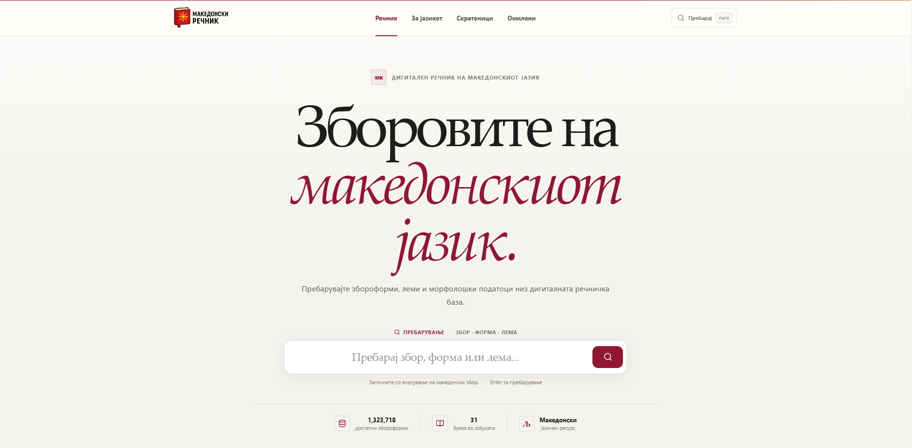
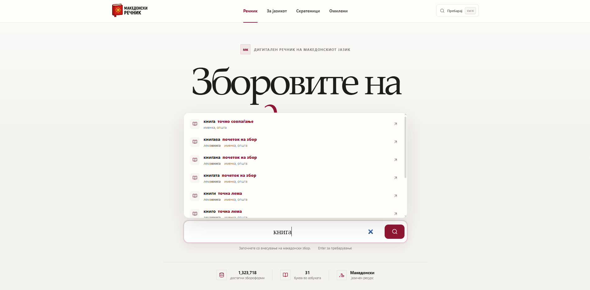
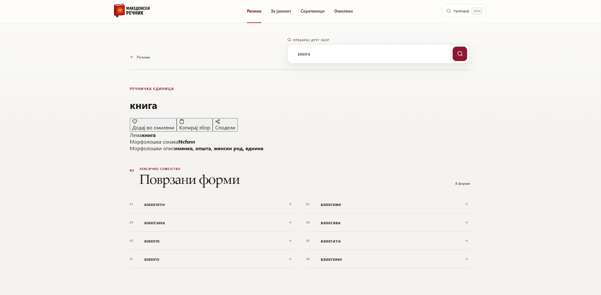
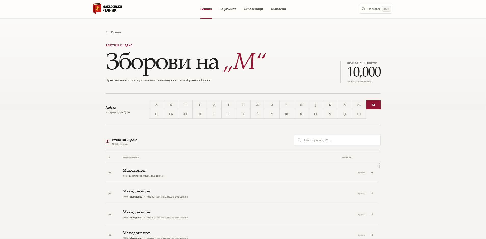
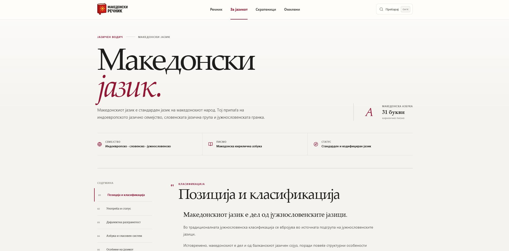
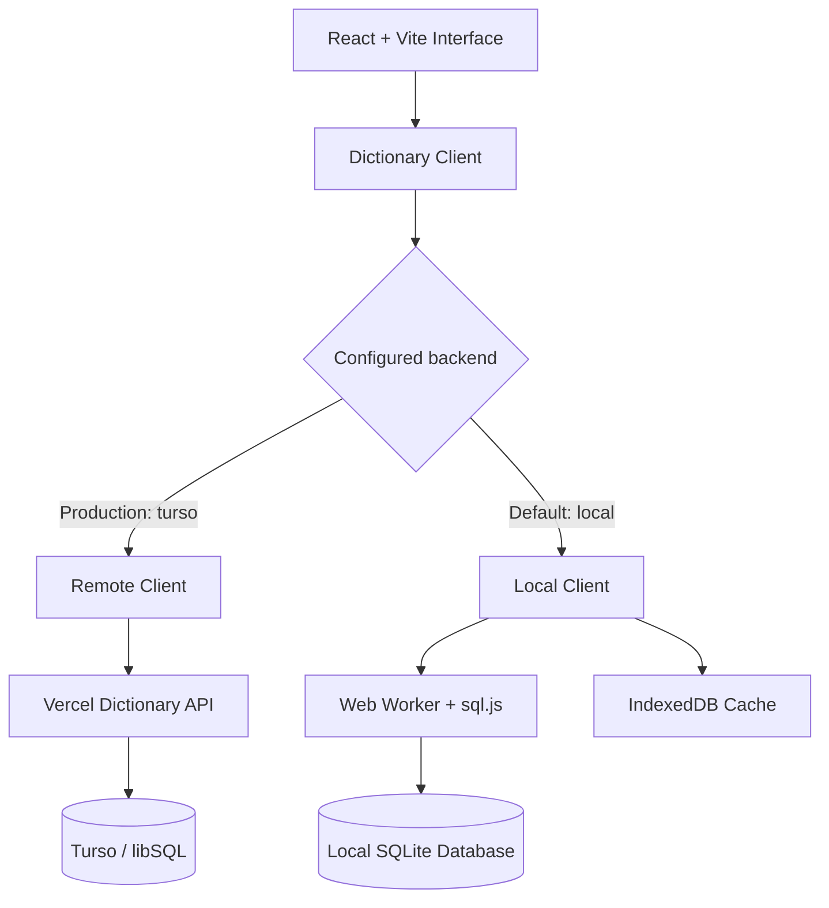

<div align="center">

# Македонски речник

### Digital Macedonian Dictionary

**Explore the Macedonian language through 1,323,718 searchable word forms.**

A modern, full-stack dictionary for discovering Macedonian word forms, lemmas, and morphological information — built with React, Vite, Turso, and Vercel.

[](https://mk-dictionary-app.vercel.app/home)

[](https://github.com/nikolasarafimov/mk-dictionary-app)
[](https://github.com/nikolasarafimov/mk-dictionary-app/actions/workflows/ci.yml)


</div>

---

## Overview

**Македонски речник** is a responsive web application designed to make Macedonian linguistic data accessible through an intuitive search and exploration experience.

The **live production application** uses a Turso-hosted SQLite database and a server-side API to search **1,323,718 word forms**. In addition to regular dictionary lookup, users can explore lemmas and morphological tags, browse the Macedonian alphabet, discover related forms, and keep track of words they want to revisit.

The project also retains a smaller, browser-based SQLite mode for local development and demonstration. Both backends share the same React interface.

| Dictionary data | Coverage | Application |
| :---: | :---: | :---: |
| **1,323,718** word forms | **31** Macedonian letters | **Full-stack** web application |

## Application Preview

<p align="center">
  
</p>
<p align="center"><sub>Homepage — the primary search experience and full-dictionary statistics.</sub></p>

### Explore the interface

<table>
  <tr>
    <td width="50%" valign="top">
      <strong>Search Results</strong>
      <p>Search word forms and lemmas, refine results, and navigate the dictionary.</p>
      
    </td>
    <td width="50%" valign="top">
      <strong>Word Details</strong>
      <p>Inspect lemmas, morphological information, and related word forms.</p>
      
    </td>
  </tr>
  <tr>
    <td width="50%" valign="top">
      <strong>Alphabetical Browsing</strong>
      <p>Explore entries by letter across the 31-letter Macedonian alphabet.</p>
      
    </td>
    <td width="50%" valign="top">
      <strong>About the Language</strong>
      <p>Discover reference information about the Macedonian language.</p>
      
    </td>
  </tr>
</table>

## Key Features

| Feature | Description |
| --- | --- |
| **Advanced dictionary search** | Exact, prefix, and partial matching across Macedonian word forms and lemmas. |
| **Autocomplete & suggestions** | Contextual suggestions while typing, with keyboard-friendly interactions and alternative search recommendations. |
| **Morphological information** | View a word's lemma, grammatical tags, and decoded morphological information. |
| **Related word forms** | Discover other entries associated with the selected lemma. |
| **Alphabetical exploration** | Browse and filter dictionary entries using all 31 letters of the Macedonian alphabet. |
| **Random word discovery** | Open a randomly selected dictionary entry. |
| **Favorites & history** | Save favorite words and revisit recent words and searches through browser-local storage. |
| **Command palette** | Access search and navigation actions using keyboard shortcuts. |
| **Language reference** | Explore Macedonian language information and categorized abbreviations. |
| **Responsive design** | A consistent reading and search experience across desktop, tablet, and mobile screens, with reduced-motion support. |

No user account is required.

## Technology Stack

| Layer | Technologies |
| --- | --- |
| **Frontend** | React 19, Vite 6, JavaScript, CSS |
| **Routing & interactions** | React Router 7, Framer Motion, React Icons, React Window |
| **Production database** | Turso / libSQL (SQLite-compatible) |
| **Server-side API** | Vercel Functions, `@libsql/client` |
| **Browser-based mode** | SQLite, `sql.js`, WebAssembly, Web Workers, IndexedDB |
| **Client-side persistence** | `localStorage` |
| **Code quality & CI** | ESLint, GitHub Actions |
| **Hosting** | Vercel |

## Architecture

The frontend accesses dictionary functionality through `src/db/client.js`, which selects a backend **at build time** using the `VITE_DICTIONARY_BACKEND` environment variable.



### Production — Turso-backed dictionary

The public deployment is configured with `VITE_DICTIONARY_BACKEND=turso`.

1. React sends dictionary operations to `POST /api/dictionary`.
2. A Vercel Function validates the operation and its arguments.
3. `server/dictionary.js` performs parameterized SQL queries against Turso using read-only application credentials.
4. The API returns only the requested results to the browser, not the entire database file.

The API exposes a defined set of dictionary operations rather than accepting arbitrary SQL from visitors. It also validates request content, enforces a JSON body-size limit, and caps operation-specific result counts. Vercel Firewall can provide additional request-rate protection.

### Local / demonstration mode

Without `VITE_DICTIONARY_BACKEND=turso`, the app uses the local SQLite implementation through a Web Worker, `sql.js`, and WebAssembly. The browser can cache the SQLite data in IndexedDB to avoid unnecessary downloads.

The checked-in demonstration database contains **28,580 word forms**. The full SQLite source file is intentionally **not included in the current repository tree or production website assets**.

## Getting Started

### Prerequisites

- Node.js 22 or newer and npm
- Git
- A local SQLite file or a configured Turso development environment for the corresponding development workflow

Clone the repository and install dependencies:

```bash
git clone https://github.com/nikolasarafimov/mk-dictionary-app.git
cd mk-dictionary-app
npm ci
```

### Option A — Run the browser-based demo

A production-style local preview works without database credentials or access to the full SQLite file:

```bash
npm run build
npm run preview
```

Open the URL displayed by Vite, typically `http://localhost:4173/home`.

This mode uses `public/msd-mk-demo.sqlite`, **not** the live Turso database.

### Option B — Develop with Vite and a local SQLite file

`npm run dev` starts the frontend with hot module replacement on port **8080**. By default, this mode expects `public/msd-mk.sqlite` to exist locally.

If you have an authorized copy of the complete SQLite database, place it at that path. Alternatively, if the file does not exist and you only need the demo dataset, use this **PowerShell** command to create a local development copy without overwriting an existing file:

```powershell
if (-not (Test-Path .\public\msd-mk.sqlite)) {
  Copy-Item .\public\msd-mk-demo.sqlite .\public\msd-mk.sqlite
}

npm run dev
```

Visit `http://localhost:8080/home`. The full source SQLite file is ignored by Git and must not be committed.

### Option C — Develop the full application with Turso

To run the React frontend **together with the Vercel API** locally, configure the linked Vercel project's **Development** environment with:

| Variable | Value | Visibility |
| --- | --- | --- |
| `VITE_DICTIONARY_BACKEND` | `turso` | Public build-time configuration |
| `TURSO_DATABASE_URL` | Your Turso database URL | Server only |
| `TURSO_AUTH_TOKEN` | A read-only Turso token | Server only; sensitive |

Then run from the project directory:

```bash
npx vercel@latest pull --environment=development
npx vercel@latest dev --listen 3000
```

Open `http://localhost:3000/home`. The local Vercel development server serves the frontend and `/api/*` functions, while database queries use Turso. This mode requires network access and valid development credentials.

**Security:** Never prefix Turso credentials with `VITE_` or commit environment files. The `VITE_DICTIONARY_BACKEND` value only selects the frontend backend; it is not a secret.

## API

The serverless backend exposes two routes:

| Endpoint | Method | Purpose |
| --- | --- | --- |
| `/api/dictionary` | `POST` | Validate and execute supported dictionary operations. |
| `/api/db-health` | `GET` | Check Turso connectivity and retrieve the number of word forms. |

For example, a dictionary search request follows this structure:

```json
{
  "operation": "searchForms",
  "args": ["книга", 10]
}
```

Supported operations include searching, lookup by word form, word suggestions, alphabetical browsing, related forms, random word selection, and batch lookup of saved words. The endpoint does not provide unrestricted SQL execution.

## Development & Quality Assurance

| Command | Description |
| --- | --- |
| `npm run dev` | Start the Vite development server. |
| `npm run lint` | Run ESLint checks. |
| `npm run build` | Generate the frontend production build in `dist/`. |
| `npm run preview` | Serve the compiled frontend locally. |
| `npm run check` | Run ESLint followed by the production build. |

Before submitting changes:

```bash
npm run check
npm audit --omit=dev --audit-level=high
```

GitHub Actions validates linting, the frontend build, demo database integrity, and required WebAssembly assets. The CI build tests the **demo configuration**; live Turso functionality is validated separately through the Vercel deployment environment.

## Deployment & Configuration

The production site is hosted on **Vercel**, with Turso configured as the primary dictionary backend. Production requires:

- `TURSO_DATABASE_URL` and `TURSO_AUTH_TOKEN` as server-side environment variables.
- `VITE_DICTIONARY_BACKEND=turso` in the frontend build environment.
- A fresh deployment whenever build-time environment configuration changes.

The full SQLite file is excluded from static deployment uploads. New changes are verified locally and in a preview deployment before being merged into `main`.

**Live application:** [mk-dictionary-app.vercel.app/home](https://mk-dictionary-app.vercel.app/home)

## Data Handling

Search history, recently viewed words, and favorites are stored in the visitor's browser. There is no user account or cross-device synchronization.

The complete database is queried server-side in production. Its underlying SQLite file is not distributed as a website asset; however, publicly accessible search results can still be collected by users. Removing the full database from the current Git tree also does not erase historical Git LFS objects or copies obtained from earlier commits.

## Author

**Nikola Sarafimov**

[GitHub](https://github.com/nikolasarafimov) · [LinkedIn](https://www.linkedin.com/in/nikola-sarafimov) · [Portfolio](https://nikolasarafimov.github.io)

---

<div align="center">
  <sub>Built to make the richness of the Macedonian language easier to explore.</sub>
</div>